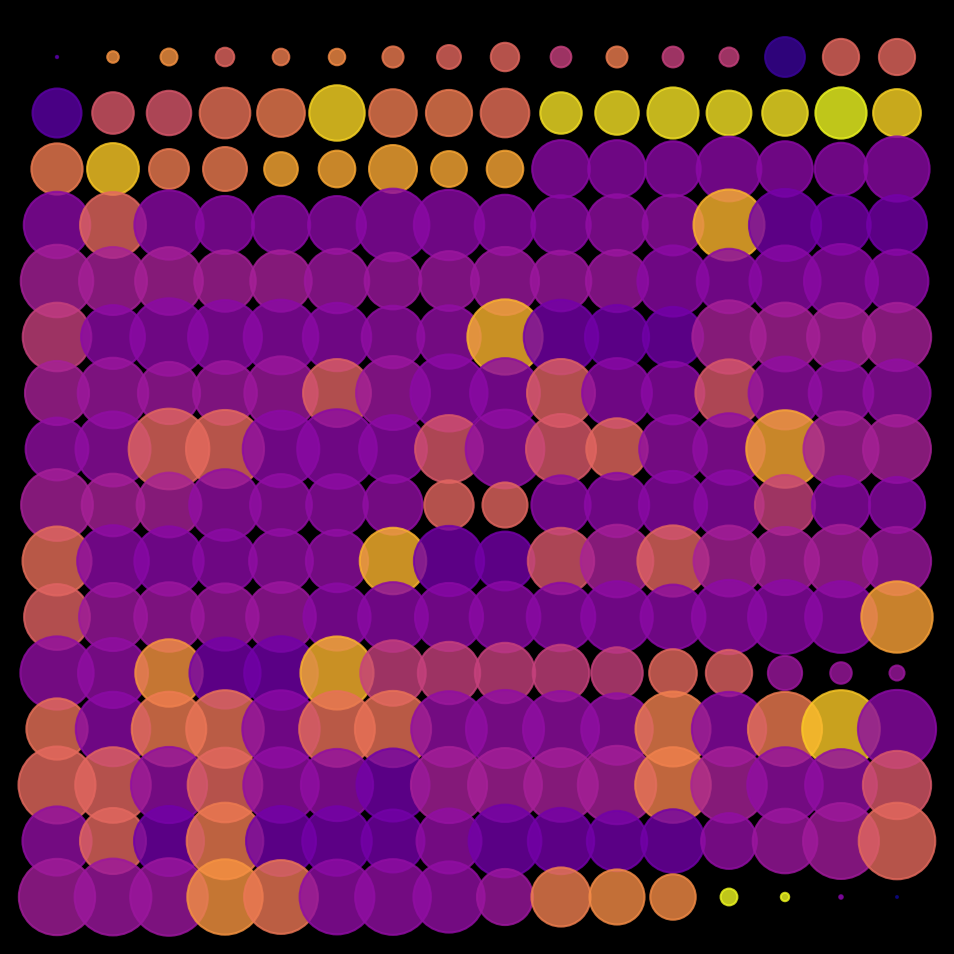
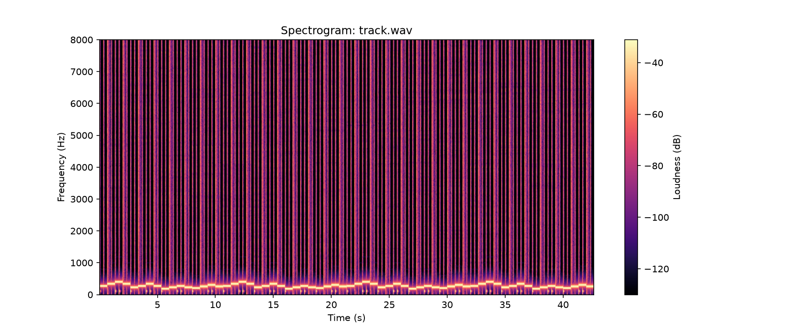

# Music × Art × ML

Learning Python and machine learning through 13 small creative projects, from generating a single beep to training a model that guesses a song's mood, and repainting photos with a neural network. Everything is tied together in one browser app.

The idea behind the whole project: **sound and images are just arrays of numbers.** Once something is numbers, it can be measured, drawn and learned from.

<p>
  
  
</p>

*Left: a 4-minute song as a painting, one circle per second (size = loudness, colour = pitch). Right: the spectrogram of a drum track made in code, with the melody visible as a staircase of notes.*

---

## What's inside

| # | Project | What it does | Main skills | File |
|---|---|---|---|---|
| 1 | First beep | Generates a 440 Hz tone and saves it as `.wav` | NumPy, sine waves, sample rate | `beep.py` |
| 2 | Tone generator | Turns typed notes like `C4 E4 G4` into a melody | Functions, note-to-frequency maths, fades | `tone_generator.py` |
| 3 | Drum machine: one bar | Kick, snare and hi-hat made from code, on a 16-step grid | Loops, mixing arrays, envelopes | `drum_machine.py` |
| 4 | Drum machine: full beat | A 32-second track with fills and a melody on top | Reusable functions, imports | `drum_track.py` |
| 5 | Song waveform | Loads a real MP3 and draws its waveform | Reading audio files, stereo to mono, Matplotlib | `song_visualizer.py` |
| 6 | Song spectrogram | Draws the song as pitch over time | Frequency, decibels | `song_spectrogram.py` |
| 7 | Song features table | Measures loudness and pitch for every second | RMS, FFT, pandas, CSV | `song_features.py` |
| 8 | Music to painting | Turns each second of a song into a circle | Mapping data to visuals, log scales | `song_painting.py` |
| 9 | Photo colour palette | Finds a photo's 5 main colours | k-means clustering (unsupervised ML) | `photo_palette.py` |
| 10 | Palette to melody | Plays a photo as a tune | Designing a mapping rule | `photo_melody.py` |
| 11 | Mood dataset | Measures 20 hand-labelled songs into a table | Labelling, feature engineering | `mood_dataset.py` |
| 12 | Mood classifier | Guesses whether a song is calm or energetic | KNN, scaling, cross-validation, classes | `mood_classifier.py` |
| 13 | Neural art | Repaints a photo in the style of a song painting | PyTorch, pretrained CNNs, gradient descent | `neural_art.py` |
| 18 | The app | One browser app for all of the above | Streamlit, caching | `app.py` |

---

## The app

`app.py` is a [Streamlit](https://streamlit.io) app with a tab for each part of the project:

| Tab | What you can do |
|---|---|
| Tone generator | Type notes, hear the melody, see its waveform |
| Drum machine | Tick a 16-step grid for each drum, set the tempo, hear the beat |
| Song visualizer | Upload a song and see its waveform, spectrogram and mel spectrogram |
| Painting | Turn the song into a circle painting and download it |
| Photo melody | Upload a photo, see its colour palette as notes, hear it |
| Mood guesser | Get calm or energetic, see the 3 most similar songs that voted, and compare its numbers with both moods |

Songs and photos are uploaded in the sidebar and processed in memory, so nothing is saved into the project folder.

---

## Setup

Requires Python 3.11 or newer.

```bash
git clone https://github.com/SamOTOT/music-art-ml.git
cd music-art-ml
python -m venv .venv
```

Activate the virtual environment:

- Windows (PowerShell): `.venv\Scripts\Activate.ps1`
- Windows (Command Prompt): `.venv\Scripts\activate`
- macOS / Linux: `source .venv/bin/activate`

Then install everything and start the app:

```bash
python -m pip install -r requirements.txt
streamlit run app.py
```

The app opens in your browser at `http://localhost:8501`.

**Note:** `neural_art.py` downloads the pretrained VGG19 weights (about 550 MB) the first time it runs. They are cached outside the project folder.

---

## Results

### Mood classifier

Twenty songs were labelled by ear (10 calm, 10 energetic) and measured into features. The model was improved through four tracked experiments, each scored with 5-fold cross-validation so every song is tested once.

| Experiment | Change | Accuracy |
|---|---|---|
| 1 | Baseline: KNN (k = 3), middle 15 seconds of each song | 0.80 |
| 2 | Measure the whole song and add peak loudness | **0.85** |
| 3 | Add 10 frequency-band features | 0.80 |
| 4 | Try k = 3, 5, 7 and a decision tree | 0.85 (all models, 4 features) |

**Final model:** KNN with k = 3 on four whole-song features (loudness, loudness change, peak loudness, brightness), **85% accuracy** on songs it never saw.

What the experiments taught:
- A single test on 5 songs swung between 50% and 100%; cross-validation gives a fair score.
- Judging a song by a 15-second slice caused **sampling bias**.
- More features made the model **worse**: with only 20 songs, extra features blur what "nearest" means (overfitting, the curse of dimensionality).
- Some songs fool every model, because their mood comes from **rhythm**, which none of the features measure. That's the obvious next feature.

### Neural art

`neural_art.py` uses optimisation-based style transfer ([Gatys et al., 2015](https://arxiv.org/abs/1508.06576)): a frozen, pretrained VGG19 measures how far a generated image is from a photo's content and a style image's textures (via Gram matrices), and gradient descent nudges the pixels until the photo looks painted. One run of 300 steps takes about 3 minutes on a laptop CPU.

Findings:
- Cropping the style image to the photo's shape, instead of stretching it, keeps its circles round and preserves more of the photo.
- A 100× range of style weight changed the result very little: the step budget and the Adam optimiser limit how far the image can move.

---

## Data not included

Songs and photos are **not** in this repo, for copyright and privacy reasons (`*.mp3`, `*.jpg`, `*.wav` and generated `*.png` files are ignored by Git). To run the scripts that use them, add your own:

- `song.mp3` / `song2.mp3` for the song scripts,
- `photo.jpg` for the photo scripts,
- `mood_songs/calm/` and `mood_songs/energetic/` folders of MP3s to rebuild the mood dataset.

The app doesn't need any of these: upload files in its sidebar instead. `mood_dataset.csv` (song names and measured features, no audio) is included, so the mood guesser works out of the box.

---

## Built with

Python · NumPy · SciPy · pandas · Matplotlib · soundfile · librosa · scikit-learn · PyTorch / torchvision · Pillow · Streamlit

---

## Author

Snehal Tirkey, B.Tech Computer Science & Engineering.
